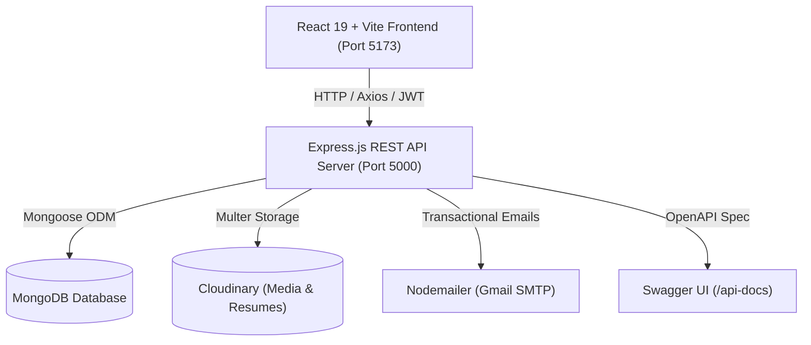

# 🚀 NaukriMitra — Next-Gen Job Discovery & Hiring Platform

<p align="center">
  
  
  
  
  
  
  
</p>

---

## 🌟 Overview

**NaukriMitra** is a full-stack, enterprise-grade job discovery and talent acquisition ecosystem tailored for the Indian employment landscape. Built with a lightning-fast **React 19 + Vite** frontend, a scalable **Express.js** REST API backend, and **MongoDB**, it connects millions of job seekers with vetted employers and automated career tools.

Whether hiring blue-collar, grey-collar, or white-collar professionals, **NaukriMitra** streamlines candidate matching with intelligent filters, AI recommendations, direct recruiter contact, online resume generation, and multi-role dashboards.

---

## 🚀 Key Features

### 👤 Candidate Features (Job Seekers)
- **Smart Job Search**: Filter by keyword, location, salary range, job type (Full-time, Part-time, Remote, Contract), and category.
- **One-Click Apply**: Apply instantly with Cloudinary-backed resume uploads (PDF/DOCX) or auto-fill from user profile.
- **Direct Recruiter Connect**: Direct phone and email contact with hiring managers for accelerated placement.
- **Interactive Resume Builder**: Create, preview, and download professional resumes directly in the browser.
- **Personalized Candidate Hub**: Track application status, saved jobs, notifications, and profile completeness.

### 🏢 Employer Hub (Hiring Teams)
- **Job Posting & Lifecycle Management**: Post jobs, edit descriptions, toggle active/closed status, and set custom requirements.
- **Applicant Tracking System (ATS)**: Review applicant resumes, update candidate stages (Pending, Shortlisted, Interviewed, Rejected, Hired).
- **Team Management & Role Delegation**: Invite recruiters or team members via email to collaborate on hiring drives.
- **Email Alerts**: Automated notifications when candidates apply or application statuses change.

### 🛡️ Admin Panel & Governance
- **Platform Analytics**: Total users, active jobs, employer metrics, and application counts.
- **Job Moderation**: Review pending job posts before they go live on the platform.
- **User Management**: Activate/deactivate accounts, moderate user profiles, and inspect system audit logs.

### ⚡ Technology & AI Enhancements
- **AI Recommendation Engine**: Content-based similarity scoring (cosine similarity on skills & job requirements).
- **Automated Email Notifications**: Verification emails, password resets, and hiring updates via Nodemailer.
- **Interactive Swagger Documentation**: Live API testbed accessible at `/api-docs`.
- **Rock-Solid Security**: JWT tokens, bcrypt password hashing, HTTP-only cookies, Helmet, and rate limiting.

---

## 🏗️ Architecture



---

## 📁 Repository Structure

```
NaukriMitra/
├── client/                     # Frontend Application (React 19 + Vite)
│   ├── public/                 # Static assets
│   ├── src/
│   │   ├── components/         # Reusable UI (Navbar, Footer, JobCard)
│   │   ├── lib/                # API client (Axios) & AuthContext
│   │   ├── pages/              # Home, Search, JobDetails, PostJob, Profile, etc.
│   │   ├── App.jsx             # Route definitions
│   │   └── main.jsx            # React root
│   ├── index.html              # HTML shell & font definitions
│   ├── vite.config.js          # Vite build config
│   └── package.json            # Frontend dependencies
│
├── server/                     # Backend API (Express.js + Node)
│   ├── src/
│   │   ├── middleware/         # Auth, validation, uploads, error handling
│   │   ├── models/             # User, Job, Application, Team, Notification
│   │   ├── routes/             # auth, jobs, employer, admin, notifications
│   │   ├── services/           # Cloudinary, Email, AI recommendation
│   │   ├── utils/              # Helper utilities
│   │   ├── index.js            # Express server initialization
│   │   └── passport.js         # OAuth strategy configuration
│   ├── seed-admin.js           # Admin initialization script
│   └── package.json            # Backend dependencies
│
├── docker-compose.yml          # Containerized deployment config
├── README.md                   # Project documentation
└── package.json                # Root package metadata
```

---

## ⚡ Quick Start (Local Setup)

### Prerequisites
- **Node.js**: v18.0.0 or higher
- **MongoDB**: Local MongoDB instance or free MongoDB Atlas cluster

---

### 1. Backend Setup

```bash
cd server

# 1. Install dependencies
npm install

# 2. Configure environment variables in server/.env
# (Refer to .env.example for required variables)

# 3. Seed an initial admin user (Optional)
node seed-admin.js

# 4. Start backend in development mode (Runs on http://localhost:5000)
npm run dev
```

---

### 2. Frontend Setup

```bash
cd client

# 1. Install dependencies
npm install

# 2. Start Vite development server (Runs on http://localhost:5173)
npm run dev
```

Open your browser at **[http://localhost:5173](http://localhost:5173)** to explore NaukriMitra.

---

## 🔑 Environment Configuration

### `server/.env`
```ini
# Database
MONGODB_URI=mongodb+srv://<username>:<password>@cluster.mongodb.net/naukrimitra
PORT=5000
NODE_ENV=development

# JWT Security
JWT_SECRET=your_super_secret_jwt_key_here

# URLs
FRONTEND_URL=http://localhost:5173
SERVER_URL=http://localhost:5000

# Cloudinary (Resume & Avatar storage)
CLOUDINARY_CLOUD_NAME=your_cloud_name
CLOUDINARY_API_KEY=your_api_key
CLOUDINARY_API_SECRET=your_api_secret

# Email Service (Gmail App Password)
SMTP_EMAIL=your_email@gmail.com
SMTP_PASSWORD=your_gmail_app_password

# Admin Credentials
ADMIN_EMAIL=admin@naukrimitra.com
ADMIN_PASSWORD=Admin@123
```

### `client/.env`
```ini
VITE_API_URL=http://localhost:5000/api
VITE_APP_URL=http://localhost:5173
```

---

## 📡 API Endpoints Overview

| Method | Endpoint | Description | Access |
|---|---|---|---|
| `POST` | `/api/auth/signup` | Register new user (Candidate / Employer) | Public |
| `POST` | `/api/auth/login` | Authenticate user & issue JWT | Public |
| `GET` | `/api/auth/me` | Fetch authenticated user profile | Private |
| `GET` | `/api/jobs/search` | Search jobs with filters & pagination | Public |
| `GET` | `/api/jobs/:id` | Get job details | Public |
| `POST` | `/api/jobs/:id/apply` | Apply for a job | Candidate |
| `POST` | `/api/employer/jobs` | Post a new job | Employer |
| `GET` | `/api/employer/applications` | Review received applications | Employer |
| `GET` | `/api/admin/stats` | Platform metrics & dashboard overview | Admin |
| `GET` | `/api-docs` | Interactive Swagger API documentation | Public |

---

## 🛡️ Security & Best Practices

- **Zero Clear-Text Passwords**: Passwords hashed with `bcryptjs` (salt rounds: 10).
- **Authentication**: Stateless JSON Web Tokens (JWT) with configurable expiry.
- **Injection & DoS Protection**: Sanitized input validation, MongoDB query parameterization, and Express rate limiters on sensitive endpoints.
- **CORS & Headers**: Tight CORS origin controls with Helmet security headers.

---

## 📄 License

This project is licensed under the [MIT License](LICENSE).
Built with ❤️ for Indian job seekers and employers by **NaukriMitra Team**.
